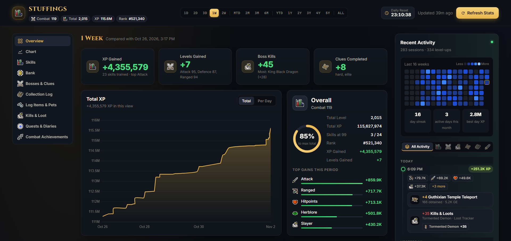

# OSRS Progress Dashboard

A self-hosted progress dashboard for your own Old School RuneScape account. It combines the official hiscores with
JSON files exported from RuneLite on your computer, turns them into readable charts and lists, and keeps the full
history locally.

## Download

| Package | Platform | Link |
| --- | --- | --- |
| Desktop app installer | Windows 10/11 | [OSRS-Dashboard-Setup.exe](https://github.com/slappingpikachu/runescape-dashboard/releases/latest/download/OSRS-Dashboard-Setup.exe) |
| Desktop app disk image | macOS 11 or later, Apple silicon (M1 and newer) | [OSRS-Dashboard-Mac.dmg](https://github.com/slappingpikachu/runescape-dashboard/releases/latest/download/OSRS-Dashboard-Mac.dmg) |
| Dashboard (PowerShell) | Windows, macOS | [osrs-dashboard.zip](https://github.com/slappingpikachu/runescape-dashboard/releases/latest/download/osrs-dashboard.zip) |

These links always point to the latest version. Release notes and earlier versions are on the
[Releases](https://github.com/slappingpikachu/runescape-dashboard/releases) page.

## Features

- **XP and levels**: gains per skill for any period, a total XP chart, per-day bars and skill comparisons.
- **Bosses and clues**: kill counts and clue completions from the hiscores, with gains per period.
- **Bank**: value over time, equipment and inventory, item changes between saves, price movements, and Grand
  Exchange offers with after-tax results against the GE price.
- **Collection log**: slots, value, recent additions with their sources, every page of the in-game log, and pets.
- **Kills and loot**: every source in RuneLite's Loot Tracker, with loot totals and a searchable drop log.
- **Quests, diaries and combat achievements**: completion status, requirements, and task lists with each completed
  diary task marked.
- **Recent activity**: a feed of every update, a 16-week heatmap and streaks.
- **Sync**: export your history on one computer and import it on another; both keep every snapshot.

Every view can be set to any period from one day to all time. Charts and periods follow the game's daily reset
(00:00 UTC); the activity feed and drop log are grouped by your calendar day.

## Requirements

- Windows 10 or 11, or macOS 11 or later. The desktop app for Mac needs Apple silicon (M1 and newer); the
  PowerShell version on a Mac needs PowerShell 7 (`brew install powershell`).
- For bank, collection log, quests, diaries, combat achievements, kills and loot: RuneLite exporting JSON files to
  `.runelite/plugin-data/osrsdatasync/<player>/`. This is the format of the OSRS Data Sync plugin on RuneLite's
  Plugin Hub. Keep RuneLite's built-in **Loot Tracker** plugin enabled for kills and loot. Without these files, the
  dashboard shows hiscores data only.

## Installation

### Windows

1. Extract [osrs-dashboard.zip](#download) to any folder, for example `Documents\osrs-dashboard`.
2. Run `start.bat`. The dashboard opens at http://localhost:8765/. The server runs in the console window that
   opens; closing it stops the dashboard.

### macOS

Run `pwsh server.ps1` in the dashboard folder, then open http://localhost:8765/.

### Desktop app (Windows and Mac)

The same dashboard is available as a standalone app that needs no console window or browser.

- **Windows:** run [OSRS-Dashboard-Setup.exe](#download); it installs without administrator rights. The app is not
  code-signed, so on first launch Windows SmartScreen shows a warning: select **More info**, then **Run anyway**.
- **Mac:** open [OSRS-Dashboard-Mac.dmg](#download) and drag **OSRS Dashboard** into **Applications**. The app is not
  code-signed, so the first time, right-click it in Applications, select **Open**, then **Open** again.

| | Windows | Mac |
| --- | --- | --- |
| Data | `%APPDATA%\OSRS Dashboard\` | `~/Library/Application Support/OSRS Dashboard/` |

- To use an existing dashboard folder instead, create a file named `root.txt` in the data folder containing that
  folder's path.
- Do not run the app and the PowerShell version (`start.bat` or `pwsh server.ps1`) on the same folder at the same
  time.
- To move your history to a second computer, or keep two computers the same, use [Sync](#using-two-computers).

Build instructions for Windows and macOS are in [app/README.md](app/README.md).

## First run

1. Enter your OSRS name. The dashboard verifies it on the hiscores, saves it to `settings.json` and takes the first
   snapshot.
2. With **Import Wise Old Man History** ticked, your earlier history is imported once if your account is tracked
   there. This can also be run later with `tools\import-wom.ps1`.
3. In RuneLite, log in, open your bank once, then open the collection log and select **Search** once, so the JSON
   files include everything.
4. Select **Update** on the dashboard.

## Data sources

Data is only fetched when you select **Update**, at most once per minute.

| Source | Used for |
| --- | --- |
| Official OSRS hiscores | Levels, XP, ranks, boss kills, clue completions and collection log slots |
| JSON files on your computer | Quests, diaries, combat achievements, collection log, bank, equipment, Grand Exchange offers, kills and loot |
| OSRS Wiki | GE prices for items you own or have owned, and names and images for new items |
| Wise Old Man | The optional one-time history import |

No other services are contacted, and nothing is uploaded.

Each update adds a snapshot to `data\history.jsonl`. Snapshots from the last 14 days are kept in full; older
snapshots are combined into one per game day, which keeps daily gains intact. Update at least once a day for
accurate daily figures.

## Using two computers

If you play on more than one computer (for example a Windows PC and a Mac), select **Sync** next to **Update** to
keep both dashboards' history the same:

1. On the computer you just played on, select **Export**. A `.osrssync` file is saved to your Downloads folder.
2. Move the file to the other computer (AirDrop, USB stick, or email it to yourself).
3. On the other computer, select **Sync**, then **Import File…**, and pick the file.

Import merges; it never replaces. Every snapshot from both computers is kept and sorted by time: hiscores, bank,
quests, diaries, combat achievements, collection log, kill totals and the drop log. Settings, prices and images stay
per computer. Nothing is uploaded; the file only goes where you move it. The files as they were before an import are
kept in `data\sync\backup-<time>\` (the newest three).

- Both computers must be set up for the same OSRS name. Log in to the same RuneLite account on both, so RuneLite's
  Loot Tracker totals are shared.
- Kills you make on one computer appear on the other only after an import. Until then, the other computer may list
  them as played without the plugin; the import removes those entries again.
- After an import, an **Update** skips this computer's RuneLite files when they are older than what the other
  computer sent (RuneLite hasn't run here since), so older quests or an older bank never replace newer ones. Once
  RuneLite runs on this computer again, its files count as usual.

## Phone access

To open the dashboard from a phone on the same network, run `enable-phone-access.bat` once as administrator. The
server window then shows the address to use. Run `tools\enable-phone-access.ps1 -Undo` as administrator to remove
access.

## Data files

| Path | Contents |
| --- | --- |
| `settings.json` | Your OSRS name and setup choices |
| `data\history.jsonl` | Hiscores snapshots (XP, kills and ranks history) |
| `data\bank\` | Bank history, item names and prices |
| `data\clog\` | Collection log history, item data, prices and layout |
| `data\progress\` | Quest, diary and combat achievement history and task lists |
| `data\plugin\` | Kill totals per update, drop log gaps, drops imported from your other computer, monster images |
| `data\sync\` | This computer's sync state and backups from before each import |
| `icons\` | Item, boss and monster images from the OSRS Wiki |

Back up the `data` folder to keep your history. Use a separate copy of the dashboard for each account.

## Configuration

The port (8765) and the update cooldown (60 seconds) are set at the top of `server.ps1`.

## Maintenance tools

These rebuild reference data from the OSRS Wiki when new content is released. Run them with
`powershell -ExecutionPolicy Bypass -File tools\<name>.ps1`.

| Tool | Purpose |
| --- | --- |
| `fetch-clog-layout.ps1` | Collection log tabs, pages and items |
| `fetch-ca.ps1`, `fetch-ca-icons.ps1` | Combat achievement tasks and monster images |
| `fetch-diaries.ps1` | Achievement diary tasks and requirements |
| `fetch-all-icons.ps1` | All item, monster and NPC images (resumable) |
| `import-wom.ps1` | Wise Old Man history import |

## Development

| Path | Contents |
| --- | --- |
| `server.ps1` | Local web server and update pipeline |
| `plugin.ps1`, `bank.ps1`, `clog.ps1`, `progress.ps1`, `wom.ps1`, `sync.ps1`, `icon-outline.ps1` | Data processing |
| `index.html`, `styles.css`, `app.js`, `vendor\` | Web interface |
| `app\` | Desktop app (Tauri and Rust) |
| `tools\` | Maintenance, release and test scripts |

Tests:

- `tools\test-plugin-files.ps1` checks how the JSON files are read.
- `tools\parity-test.ps1` compares the desktop app's output with the PowerShell version on copies of your data.
- `tools\make-release.ps1` builds the distributable zip and checks it for personal data.
